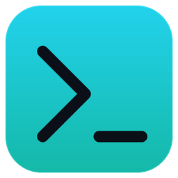

<p align="center">
  
</p>

<h1 align="center">amux</h1>

<p align="center">
  <b>One task queue. Every machine you own. A team of coding agents you can drop in on at any time.</b>
</p>

<p align="center">
  <a href="https://github.com/nitecon/amux/releases/latest"></a>
  <a href="https://github.com/nitecon/amux/actions/workflows/go-packaging.yml"></a>
  <a href="LICENSE"></a>
</p>

amux is a distributed agent multiplexer. It runs Claude, Codex, and Antigravity
agents on your Linux, Windows, and macOS machines, feeds them from one shared
task queue, and streams every agent's conversation to your desktop. Open any
conversation on any machine, read what the agent is doing, and type to it.

## Why amux

- **Drop in on any agent.** Every task runs in a live conversation with streamed
  replies and collapsed, inspectable tool calls. Pick an agent on another
  machine from the Agents list and message it mid-task. Your prompt queues
  behind the running turn instead of interrupting it.
- **One queue, many machines.** Idle agents pick up queued tasks automatically.
  Pin a task to `linux`, `windows`, or `macos` and it runs on a machine of that
  OS, so platform-specific work is built and tested where it belongs.
- **Agents review each other.** Finished work with file changes can queue
  separate code and documentation reviews, preferring an independent reviewer
  on the other provider. Decisions that need a human go to **User review**.
- **Built to survive restarts.** Tasks, conversations, and permission requests
  are stored on the server. Close the desktop, lose the network, or reboot a
  worker: agents keep running and resume their exact provider session.
- **Native protocols, no terminal scraping.** amux talks to Claude, Codex, and
  Antigravity over their own structured interfaces, so permission prompts,
  cancellation, and session resume all work.
- **Headless or desktop.** A console-only server can run the same worker pools
  as the desktop app. The server needs no display, keychain, or login.
- **Secure by default.** Machines enroll with a peering key that expires in ten
  minutes, then connect over mutual TLS with certificates that renew
  themselves.
- **Agents arrive equipped.** Each agent gets an MCP server with task tools,
  work submission, code and knowledge-graph search, and durable memory.
  Nothing extra to install.

## Get started

You need Git and at least one signed-in agent CLI
([Claude Code](https://claude.com/claude-code),
[Codex](https://developers.openai.com/codex), or
[Antigravity](https://antigravity.google)) on each machine that runs agents.

Run the same command to install, reinstall, or upgrade. It fetches the
[latest release](https://github.com/nitecon/amux/releases/latest), checks it
against the published checksums, and replaces any existing install in place.
No root or administrator rights needed.

**Linux (x86-64)**: installs to `~/amux`

```sh
curl -fsSL https://raw.githubusercontent.com/nitecon/amux/main/install.sh | sh
```

**macOS (Apple Silicon)**: installs `~/Applications/amux.app`

```sh
curl -fsSL https://raw.githubusercontent.com/nitecon/amux/main/install-macos.sh | sh
```

**Windows (x86-64, PowerShell)**: installs to `%LOCALAPPDATA%\amux`. Close amux first.

```powershell
irm https://raw.githubusercontent.com/nitecon/amux/main/install.ps1 | iex
```

Prefer to click? Download the archive for your OS from the
[latest release](https://github.com/nitecon/amux/releases/latest) and extract
it. Each bundle holds the desktop app, the `amux` CLI, and the agent tools.
Keep the files together.

### Your first task

1. **Choose a mode.** On first launch pick **Server** to host everything on
   this machine. That is all a single machine needs.
2. **Add a project.** Point amux at a folder of repositories, attach an
   existing checkout, or clone one from its Git URL.
3. **Queue work.** Choose **New task**, write a title and specification, and
   create it. amux starts an agent for each provider CLI it finds, and an idle
   one claims the task.
4. **Drop in.** Open the task's conversation to watch, answer permission
   requests, or send the agent a message.

Want more agents on a project? Open the **Native worker pool** panel, pick a
provider and a number of slots, and choose **Start pool**.

### Add another machine

On the host, open **Settings → Gateway**, enable remote hosting, and choose
**Generate peering key**. On the other machine, install amux, pick **Client**
on first launch, and enter the host's address and the key. Open the same
repository there. Both machines now share one queue, and you
can open either machine's agents from either desktop.

### Run a headless worker

A machine with no display can host agents with just the `amux` CLI from the
same bundle:

```sh
amux client enroll --server https://gateway.example:24182 --state-dir ~/.amux/cluster  # peering key on stdin
amux --generate-client-config   # then list your projects and providers in ~/.amux/config.yml
amux client run
```

To run the server itself without a desktop, see the
[deployment guide](deploy/README.md) for systemd, Docker, and TLS setup.

## Everyday operations

| I want to… | How |
| --- | --- |
| Update amux | **Settings → Updates**, or `amux --update` from the CLI. See [updates](docs/updates.md). |
| Enroll another machine | **Generate peering key** in Settings, or `amux server peering-key` on a headless host. |
| Create and manage tasks from a shell | `amux tasks --server URL --project IDENT list`. See [task commands](docs/Operations.md#task-and-project-commands). |
| Run agents from a shell | `amux worker pool --provider codex --slots 2 …`. See [worker pools](docs/Operations.md#worker-pools). |
| Stop approving the same command | Choose **Always allow…** on a permission card. See [tool approval rules](docs/Operations.md#tool-approval-rules). |
| Choose how agents publish work | Direct commit and push, or a pull request per task, under **Work submission settings**. |
| Turn automatic reviews on or off | **Server plugin settings** in the desktop app. |
| Host a server for a team | [Deployment guide](deploy/README.md): systemd, Docker, and mTLS enrollment. |

## How it fits together

```text
            ┌──────────────────────────────┐
            │         amux server          │
            │ tasks · conversations · mTLS │
            └──────────────┬───────────────┘
        ┌──────────────────┼───────────────────┐
┌───────┴────────┐ ┌───────┴────────┐ ┌────────┴───────┐
│ Linux desktop  │ │ Windows desktop│ │ headless client│
│ Claude · Codex │ │ Claude · Codex │ │  Codex pool    │
└────────────────┘ └────────────────┘ └────────────────┘
```

The **server** owns the task queue, conversations, and enrollment. A
**client**, either the desktop app or the headless CLI, runs agents in local
checkouts and streams their conversations back. The desktop app can host the
server for you, and it keeps running after you close the window.

## More documentation

- [Operations](docs/Operations.md): CLI reference, worker pools, messaging, and desktop options
- [Deployment](deploy/README.md): standalone server, Docker, systemd, and headless clients
- [Updates](docs/updates.md): updating and release packages
- [Build from source](docs/SourceBuilds.md)
- [Contributing](docs/Contributing.md) and the [coding guidelines](docs/CodingGuidelines.md)
- [Changelog](CHANGELOG.md)

## License

[Apache 2.0](LICENSE)
