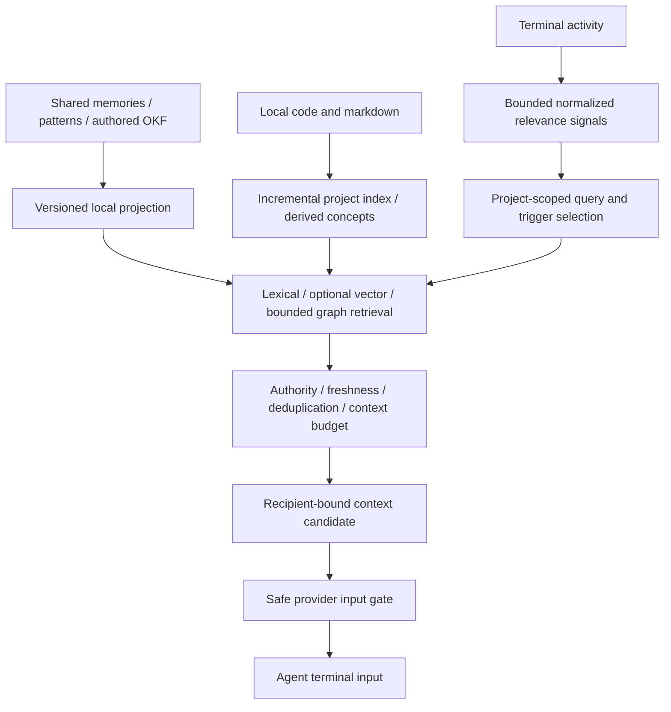

# Memory, indexing and live context architecture

Status: research and proposed implementation architecture, 2026-10-26. No runtime
changes are implemented by this document. The actual agent implementation goals,
dependencies, and acceptance criteria live in
[`docs/goals/MemoryArchitecture.md`](goals/MemoryArchitecture.md). `docs/goals/` is
intentionally ignored by Git and must be supplied separately for agent handoffs.
The durable design belongs here; the goal file is agent working data.

## Objective and relationship to the server

Bring persistent memories, patterns, OKF concepts/relationships, code indexing and
retrieval into amux, then use observed terminal activity to surface useful context
automatically. An agent should not have to run a memory lookup command to receive
relevant context. The native terminal and task UI remain the frontend.

Use the topology, authentication, snapshot download, offline journal/outbox and
authority rules in [ServerArchitecture.md](ServerArchitecture.md). mTLS secures
node traffic; it is not the mechanism for injecting context into a local agent.
Retrieval and injection must also function without a network connection.

Amux can observe **rendered terminal text and user input**, not an agent's private
reasoning or complete internal context. A terminal may expose progress, tool
commands, errors, file names and explanations. Treat these as relevance signals,
not proof of intent, instruction authority or semantic receipt. No hidden-reasoning
capture is required or assumed.

## Research baseline and reuse map

Pinned source revisions are the same as the server design:

| Existing component | Relevant source | What moves into amux |
| --- | --- | --- |
| Gateway at `f0604142ada28bbdf7e1a97572079012565cf56d` | `crates/gateway/src/db.rs`, memory and pattern handlers in `routes.rs` | Shared memory CRUD/push/pull/discovery; canonical IDs, per-project revisions, hashes, provenance, client mappings and tombstones; global patterns with comments/version/state. Artifact chunks also have text/vector fields. |
| agent-memory at `41a3b76401b5044e4dea7bfdb494965954aaee7b` | `memory/src/db/{mod,queries,models}.rs`, `concepts`, `okf`, `search`, `embedding.rs`, `gateway_sync.rs`, `sync.rs`, `render`, `project.rs` | Durable memory history, working context, OKF import/export and graph projection, FTS5/BM25, vector search, reciprocal-rank fusion, optional reranking, scope/trust modifiers, bounded graph expansion, and revision-aware synchronization. |
| agent-tools at `84993127c310ebf62a4ef656a0ebb58a7c30c2c1` | `crates/agent-knowledge/src/{store,knowledge,okf}.rs`, `crates/agent-symbols`, index orchestration in `crates/agent-cli/src/main.rs` | Project code/symbol index, references/imports, markdown sections, authored OKF, derived code concepts, provenance, relationships and observations. |
| Amux | [desktop_events.rs](../src/desktop_events.rs), [delegation_process.rs](../src/delegation_process.rs), [readiness.rs](../src/readiness.rs), [recipient.rs](../src/recipient.rs), [submission.rs](../src/submission.rs), [delivery.rs](../src/delivery.rs), [vendored terminal](../vendor/iced_term/src/terminal.rs) | Current terminal observation/notification boundary and retained library primitives for recipient fencing, guarded input and durable attempts. The library primitives are planned memory reuse, not the current task-notification scheduler. |

The gateway's memory store is not the local hybrid search engine. Its project
revision indexes are not a substitute for the code index or OKF graph. Porting only
gateway tables would omit much of the requested capability.

The local engine has its own versioned schema: memories, working context,
concepts, revisions, sources, verifications, relationships, tombstones and search
segments. Agent-tools has another project index. Preserve boundaries initially;
do not merge different `memories`/schema-version tables merely because they use
SQLite. Keep authored/gateway data distinct from rebuildable projections.

## Storage and ownership

| Store | Authority and placement | Replication/rebuild behavior |
| --- | --- | --- |
| Shared gateway application SQLite | Canonical shared memories, patterns, artifacts and their existing provenance, on the designated server | Included in scoped application snapshots and change journal; client keeps a durable replica. |
| Memory engine SQLite | Imported canonical resources plus node-local memories, working context, history and derived retrieval state | Initial version preserves agent-memory schema. Maintain explicit canonical/local ID mappings. Shared changes enter the server through revision-aware operations. Never replace local-only data with a snapshot. |
| Project/code index SQLite | Node-local checkout facts, markdown/OKF segments, symbols and derived concepts | Rebuild from the local checkout; retain repository/commit/content hashes and provenance. A remote index must not silently describe a different local checkout. |
| Local outbox/delivery state | Node-local pending memory mutations and injection attempts | Durable across offline restart; never downloaded from another node as local ownership. |
| Model cache | Versioned embedding/reranking assets on each participating node | Separate from database export. Missing models must not prevent lexical retrieval or terminal use. |

Shared pattern and memory ingestion should generate deterministic searchable
projections. Derived segments/edges can be replaced when their source revision
changes, while authored records/history remain intact. Capture source ID, revision,
content hash, namespace, project, authority, lifecycle and provenance with every
projected result. Existing authority/trust semantics must survive the port.

Keep different node checkouts scoped by canonical repository and checkout identity.
Reuse amux's root-scoped [project identity](../src/project_identity.rs), with an
explicit mapping to gateway project IDs. Do not collapse unrelated repositories
with matching basenames. Global memories/patterns retain explicit global scope;
other-project recall follows permissions and relevance policy.

Working context is an explicit handoff record, not a transcript buffer. Local
terminal text must not automatically become durable memory, a global pattern, or
an authoritative Observation. A later capture feature would need separate scope;
retrieval-driven context delivery is sufficient for this request.

## Porting strategy and dependency constraints

Copy or adapt the reusable engines into modules/crates **inside this repository**,
preserving upstream notices and behavior fixtures. Do not require subprocess
calls to installed `memory`/`agent-tools`, or absolute path dependencies on sibling
projects, for normal operation. Keep their existing tools usable during migration.
Compatibility changes in those projects require delegated tasks to their owners.

There is a concrete integration hurdle: agent-memory uses rusqlite 0.31, while the
gateway uses 0.39. Resolve the native SQLite dependency to one compatible version
before attempting to combine the code. Preserve schema ownership and test imports;
matching the crate version does not make their database formats interchangeable.
The agent-memory library exposes core modules, but CLI/hook orchestration and some
sync paths need extraction/adaptation; this is not a dependency-only change.

Port code indexing from agent-tools' symbol/index engine and orchestration rather
than inventing a new parser. Run incremental indexing on local file changes with
debounce and cancellation, honoring existing ignore rules and size limits. Remove
or mark stale derived resources when files disappear or content hashes change.
Do not synchronously parse repositories on terminal redraw or retrieve an entire
graph for each query. Embedding and index workers run outside the render/PTY path.

## Retrieval pipeline

Begin with deterministic literal/keyword, file/symbol and error-signature matches,
then lexical retrieval over the existing FTS indexes. Reuse hybrid ranking when
models are available. Existing `hybrid_search` performs BM25, embedding/vector
retrieval and reciprocal-rank fusion, optional reranking, bounded graph expansion,
trust modifiers and project/global boosts. Preserve its tests and metadata.

One required adaptation: the current hybrid function propagates embedding failure;
only optional reranking has a fallback. Add an explicit lexical-only path for
fresh offline installs and failed model initialization. The current embedding code
uses fastembed's AllMiniLML6V2 with a process-wide model mutex; vector search reads
stored embeddings. Bound corpus work and measure cost before considering a new
vector database. Store model ID/dimensions and regenerate incompatible vectors;
never compare vectors from different models as if interchangeable.

Filter by authorization, project/global scope and lifecycle before delivery. Prefer
active authored/user guidance over derived inference; suppress tombstoned,
superseded and deprecated content. A strong term match alone does not authorize
cross-project disclosure. Preserve source URI/revision and show why a result was
selected. Expand graph neighbors only to bounded depth/count with typed relations.

Proposed initial limits for measurement: 8 KiB normalized signal window, one
coalesced query per active terminal per second, three results and roughly 1,200
tokens per context envelope, one envelope per safe input opportunity, and a
30-second relevance cooldown. These are tuning proposals, not existing guarantees.
Use deterministic ties and a hard byte cap as well as approximate token counts.
Discard stale query results if recipient/project/generation or relevant source
revision changes while retrieval is running.

Preserve existing memory push/pull APIs. An additive local retrieval service can
expose search/context and typed OKF query/import/export through the embedded
backend, with the same mTLS permissions if used remotely. The terminal path should
call the local engine directly so a network request is never required for recall.
Do not tunnel a memory query through the task-event WebSocket protocol.

## Observing terminal activity

The vendored terminal exposes bounded live-screen/grid observations. The current
desktop observes terminal output and tees user input, reporting activity through
`desktop_events.rs` and `event_client.rs` to the server's Presence controller.
The backend coalesces wakeups, and observations exclude scrollback; polling the
screen is not a lossless stream of every output byte. Future memory observation
should consume this existing boundary without restoring a client scheduler.

For the initial implementation, consume bounded stable visible-text changes and
user-submitted prompt boundaries, tagged with terminal ID, recipient generation,
session, workspace/project, output sequence and timestamp. Normalize redraws,
ANSI styling and carriage-return updates through the terminal parser; do not run
regexes on arbitrary raw escape sequences. Deduplicate repeated screen fragments.
If complete short-lived output detection later proves necessary, add a bounded
passive tap at the parsed PTY-output boundary in the vendored terminal; never add
a second reader competing with the PTY parser. This completeness tradeoff must be
measured in replay tests.

Useful initial signals include compiler/test errors, file paths, symbol names,
task vocabulary, explicit project/pattern terms and repeated failures. Use bounded
literal rules first and a linear-time regex engine if regex triggers are needed.
Do not conflate gateway guidance patterns with executable matcher definitions:
associate trigger metadata with a pattern ID/revision or keep it in a small local
rule registry. Never interpret pattern content as a command or plugin.

Exclude secrets/password entry, unowned shells and unrelated terminals. Keep the
short signal window local and ephemeral; send resource changes through sync, not
raw terminal transcripts. Dropping observation work under load is acceptable;
blocking PTY reads, losing user keystrokes or degrading terminal rendering is not.
An observation merely schedules retrieval; it cannot mutate tasks or grant claims.

## Safe context delivery

Detecting relevance and writing agent input are separate stages. Queue a context
candidate while the agent is busy. Deliver only at a verified empty input prompt,
or through an explicitly supported provider context interface. Generic PTY writes
cannot safely inject into an arbitrary running tool, shell, editor, password prompt
or agent approval dialog. A busy agent may receive context at its next safe turn;
there is no universal mid-reasoning insertion interface.

Current task notifications pass through the server event router and the desktop's
`desktop_events.rs` input boundary. Native process discovery and verification
live in `delegation_process.rs`; teed drafts and terminal output reports feed the
server's idle/busy decisions. Input verification and delivery are checked again
before the final write. Local pending task notices are ephemeral; the server
owns durable events and controller delivery outcomes.

The former selected-task reminder UI and client dispatch-recovery scheduler are
removed. Their underlying library primitives remain available: `ReadinessGate`
(`readiness.rs`), exact recipient/checkpoints (`recipient.rs`), durable attempt
fencing (`delivery.rs`) and checked native submission (`submission.rs`). They
are not wired into current automatic task notifications and are not a second
scheduler. Their contract and installed-provider probes retain useful safety
evidence for the planned memory-context work.

`ReadinessGate` is provisional Linux/Codex 0.163.0 support with exact layout,
native process/foreground checks and settling rules. It is not a general
Linux/Windows/Claude/Gemini solution. Build and validate each provider/platform
adapter; unsupported cases retain a pending native context preview instead of
guessing readiness. Terminal appearance alone never proves recipient identity.

Reuse the retained recipient checkpoints and durable attempt fences for memory
context, with its own candidate/envelope type and deduplication namespace.
`submit_literal` still accepts only a compact ASCII line of at most 1,024 bytes,
wraps it as a gateway message and appends Enter. Larger memory envelopes require
a deliberate bounded submission path, not silently widening this function or
misreporting context as a task notification. Controllers own context intent and
outcomes; the client must still fence uncertain writes at the actual native
input boundary. Do not reintroduce an independent client recovery scheduler.

Each envelope includes a delivery UUID, source IDs/URIs and revisions, project,
selection reason, and bounded quoted context. Strip terminal controls and unsafe
paste delimiters. Treat retrieved content and terminal output as untrusted data;
they cannot override the user's instructions or authorize tool execution. Keep
source authority explicit and do not launder generated concepts into user rules.

Before enqueue: verify current process/recipient/project and empty prompt; reserve
the durable attempt; then recheck immediately before the input write. If the user
types, the terminal changes, the process restarts or the tab is replaced, defer or
retire the candidate. Input submission is serialized with existing delivery paths.
Never overwrite typed input or automatically answer an approval prompt.

An injection can create a new agent turn and consume tokens. Provide native
enable/pause controls per workspace/provider and a visible delivery history. These
are ordinary feature settings, not a confirmation dialog for every result. Default
automatic delivery should be enabled only for adapters that have passed the safe
input acceptance tests; unsupported adapters still retrieve and preview context.

Deduplicate by recipient generation, canonical resource revision and trigger/query
fingerprint. Suppress the injection's own echo and resulting immediate redraws to
avoid feedback loops. Expire low-value pending candidates and enforce cooldowns.
Record selected/deferred/attempted/enqueued/uncertain/retired separately. A PTY
enqueue or visible echo proves neither model consumption nor task execution.
Never blindly resend an uncertain attempt after a crash or reconnect.

## Offline, synchronization and compatibility

Keep a client-side memory projection usable from the last server snapshot plus
local changes. Use revision/hash preconditions, retained base content, tombstones,
stable operation IDs and explicit conflicts on reconnect. Agent-memory's
`gateway_sync.rs` is useful prior art: it preserves endpoint identity, reconciles
acknowledged history, and rejects divergent overwrites and resurrection.

Patterns, authored concepts and relationships need their own replicated resource
changes; memory push/pull alone does not transport the whole knowledge graph.
Derived code facts remain checkout-local initially. To exchange authored OKF, port
the existing bounded import/export codecs with original IDs, provenance, relations
and trust. Do not assume existing gateway memory sync transfers every OKF field.
Add compatibility fixtures and a versioned envelope for any missing shared fields.

A canonical application snapshot is enough to restore shared source records, but
search requires projection/indexing. Publish an optional derived memory SQLite
snapshot with its schema/model versions and canonical watermark, or rebuild from
the source snapshot locally. A stale derived snapshot must catch up before it is
used for current-source claims. Keep separate manifests per store; SQLite WAL
transactions across attached files are not an atomic set, as described in the
[SQLite WAL documentation](https://www.sqlite.org/wal.html). Local code indexes and
model assets are separate from shared database downloads. A database download alone
does not make a never-provisioned model usable offline; lexical fallback is required.

## Delivery sequence and acceptance

First port storage, codecs and search fixtures without terminal injection. Then
wire canonical memory/pattern changes into projections and offline sync. Port local
code/OKF indexing next. Add passive terminal matching and a native preview, followed
by guarded automatic delivery for validated provider/platform adapters. Expand
adapter coverage only with evidence. External notifications, autonomous memory
rewriting, transcript harvesting and new agent-tool workflows are outside scope.

Required validation includes revision/history/OKF round trips, Unicode/markdown
segmentation, ignored/deleted files, stale checkout facts, graph bounds and trust
ordering, model mismatch, absent models, cold offline installation, snapshot catch-up,
concurrent edits and tombstones. Replay noisy terminal traces to measure match
quality and query/render cost. Test partial output/redraws, multiline errors,
secret entry, user typing races, busy/approval prompts, process replacement, tab
restart, injection echoes, crash between write and persistence, and duplicate
events. Acceptance requires no input into an unverified recipient, no automatic
retry of uncertain writes, and useful recall during a network outage.

Resolve before release: trigger authoring location, initial provider/platform
support matrix, automatic-delivery defaults, retrieval budgets and relevance
thresholds, working-context sync policy, and the exact shared OKF envelope. These
are implementation decisions to validate, not claims of completed functionality.
