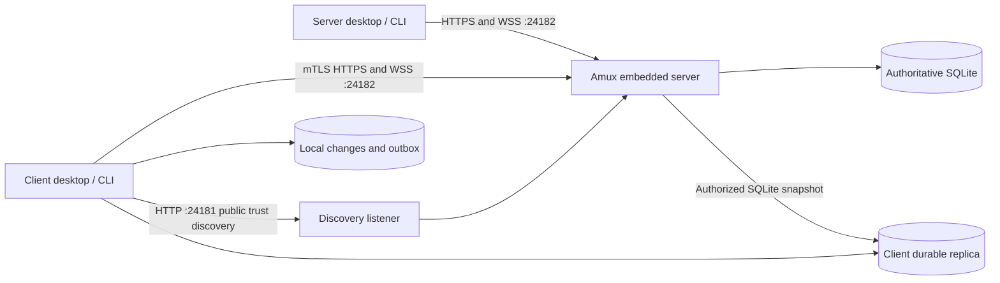

# Embedded server architecture

Status: research and proposed implementation architecture, updated 2026-10-27.
The earlier S1–S6 goals and detailed topology/enrollment defaults are **examples
only for now**, not approved implementation gates or evidence of implemented behavior. The example
agent implementation goals, dependencies and acceptance criteria live in
[`docs/goals/ServerArchitecture.md`](goals/ServerArchitecture.md). `docs/goals/` is
intentionally ignored by Git and must be supplied separately for agent handoffs.
The durable design belongs here; the goal file is provisional agent working data.
The owner's current ordering is client-mode research, a complete API-compatible
backend release, and only then a separate server-listening/mTLS release. Research
and verified compatibility results must refine the example goals before execution.

## Two-release implementation sequence

### Research first: current client behavior

The task-tool migration brought task operations into the amux CLI; it did not
make the gateway database local. The desktop and CLI still connect to one remote
authority using saved gateway URL/API-key preferences. Preserve that working client
mode, including reqwest REST calls, WebSocket events, exact agent ownership,
requester subscriptions, receipts, task cancellation and dispatch recovery. Neither
an API proxy nor a task-only replacement establishes embedded gateway parity.

Existing HTTP/WSS integration points are `src/gateway.rs`,
`src/gateway_preferences.rs`, `src/gateway_stream.rs`, `src/desktop_delegation.rs`,
`src/dispatch.rs` and `src/task_requester.rs`. Plaintext WebSockets are currently
limited to loopback. Release 1 must preserve that restriction: validate the embedded
backend locally and retain existing HTTPS/WSS hosting for remote deployments until
the second release supplies its secure listener. Do not silently switch an existing
configured deployment to a new, empty local database.

Client-mode research must identify every gateway request and credential source,
project resolution, connection ownership, restart path and durable journal key.
Today the event journal is namespaced by URL/API-key identity, and dispatch recovery
is origin-bound. Secure transport migration and later certificate rotation must
preserve server identity and recovery fences; they must not silently create a new
consumer or replay an uncertain mutation against another server. Offline replication
and conflict reconciliation remain separate capabilities to prove, not properties
of merely storing a SQLite copy.

The implementation audit found three independently constructed transports:
`Gateway` HTTP, `Dispatcher` HTTP and the WebSocket connector. All must load the
same immutable credential generation. `delegation_connection.rs` reconnects the
socket, while `desktop_recovery.rs` retains dispatch credentials; neither may keep
using an old certificate after the ordinary REST client changes. A same-authority
credential refresh must preserve the durable consumer/cursor and uncertain-request
state rather than invoking the authority-changing reset in `save_preferences`.

Startup must distinguish absent settings, explicitly saved settings, environment
configuration and invalid saved settings. Only a genuinely fresh, unconfigured
installation should choose server mode automatically. An unreadable or invalid
saved connection is an error, not permission to create a different authority.

The imported API bearer key grants administrator-compatible access. The secure
listener therefore needs an explicit verified-node principal and permissions;
injecting the bearer key on behalf of every mTLS client would turn ordinary peers
into administrators. Node identity remains separate from the existing agent,
instance, session and dispatch ownership fences.

The existing Discord plugin detaches its worker and has no stop operation. Native
hosting must retain process-lifetime ownership or provide a proven shutdown
contract before live mode changes/restarts can safely replace that worker. The
existing application has no OS key-store abstraction; protected private-key
storage is new work, not an existing preferences capability.

### Release 1: existing gateway API and database compatibility

Pin the clean gateway `main` revision and inventory every existing backend route,
method, authentication path, request/response schema, status/error response,
database migration/index/trigger, event stream and background database job. The
initial refreshed baseline is gateway commit
`986d84544aae086579c72349a1afc366cef6b589`; the sibling checkout is on an older,
dirty branch and must not be copied as an authoritative release baseline.

Embed the backend in this repository so an amux instance can act as the standalone
gateway with the same configured API-key behavior and native clients. Preserve the
full backend API surface, not only the routes currently exercised by task commands.
Keep the current native frontend and omit browser-page serving. Retain the existing
external channel plugins, configuration, ingress and workers during compatibility
testing and cutover. Compare plugin-dependent API behavior against the existing
gateway with the same plugin configuration; do not substitute a native adapter,
new generic unsupported responses or silently drop routes during this phase.

The owner requires repeated switching between the existing gateway and the new
amux server before full cutover. The test plan must record switch-forward and
switch-back runs using explicit isolated/copied database profiles, the same API
contracts and controlled plugin ownership. Do not run two consumers of a live
channel integration concurrently or reuse the production database for experiments.
Post-cutover decoupling of project registration and internal messaging from external
channels is deferred to task `01a17b97-b8c9-73e2-89c5-ae541ca0e814`; it is not part
of either initial release's compatibility changes.

Prove parity using the pinned upstream contracts and a differential harness running
the original and embedded routers against isolated database fixtures. Include
positive and negative authorization, identity/OS fencing, requester subscriptions,
errors, pagination, events/receipts, interrupted requests and database upgrades.
Validate the actual amux desktop/CLI against the embedded backend, then publish a
full native release. This release must work with the established gateway URL/key
workflow before certificate transport is introduced.

See [server/Compatibility.md](server/Compatibility.md) for the compatibility
entry point, retained configuration and reproducible differential checks.

### Release 2: native server lifecycle, listening and mTLS

Begin after release 1's published artifacts and complete API compatibility have
been verified. Build the default server versus explicit client topology, local
server ownership and headless lifecycle, secure operational listener on 24182,
public discovery on 24181, enrollment and certificate rotation on that proven
backend. Refine the example enrollment/replication details below using the research
results; porting the API is not permission to weaken its existing authorization.

Use configured legacy connections during migration, and explicitly distinguish
API-key compatibility from the new peering invitation and node-certificate flow.
Publish and verify a second full native release after server/client and secure
transport acceptance tests pass. A single combined release, documentation alone,
or a facade forwarding to an external gateway does not meet these two gates.

### Release 2 implementation boundary

The native implementation adds Server, Client and Legacy connection modes to
Settings. A fresh install without saved or environment gateway configuration
starts its own loopback server; network hosting is an explicit Settings choice.
Existing gateway URL/key configuration stays in Legacy mode. The bundled CLI
owns the server process and its SQLite profile lock; closing its owning desktop
or CLI stops that process. Attaching to an existing headless server does not
transfer ownership. A parent file lease and platform process handles prevent an
abandoned child from keeping channel consumers running after its owner exits.

Operational REST and WebSocket traffic uses mTLS on 24182. Port 24181 publishes
only discovery and the public installation root. The on-demand peering key embeds
the cluster identity, root fingerprint and discovery port. Clients verify that
fingerprint and the server hostname before sending the key over TLS with a locally
generated CSR. The active invitation lasts at most ten minutes; generating another
invalidates it, and restarting the server clears it. Only its verifier is stored
in the separate security database. Settings provides Generate new, Copy and the
remaining lifetime; client Settings accepts a server address and peering key.

The initial implementation uses a stable installation CA directly signing 30-day
leaf certificates. It renews client and server leaves with fresh keys after
two-thirds of their lifetime, retaining current/previous identities for at most
seven days and never past expiry. Activation and live connections govern earlier
retirement. Pending issuance and activation survive interrupted responses without
persisting the peering secret. A renewal failure allows continued use of a valid
current certificate; expired or revoked credentials cannot authenticate. The
rotatable intermediate and shared-root trust transition described below remain
future design work, not functionality supplied by leaf renewal.

Client preferences contain public identity and profile references. Private keys
use owner-only files/directories on Unix and current-user DPAPI on Windows. The
same profile supplies REST, dispatch and WebSocket credentials; renewing a leaf
preserves the cluster/node journal namespace and reconnects streams with their
existing consumer/cursor. Nodes receive explicit authorization rather than an
injected administrator bearer token. Local administration additionally requires
the reserved local certificate and a loopback connection.

External channel plugins remain required for the operations that use them.
WhatsApp provider ingress is a separate opt-in, HMAC-protected listener, never a
route on public discovery. Database download, an authoritative offline replica,
live memory injection and CA-root rollover remain separate work. This release
does not claim those capabilities from having ported the gateway backend.

## Direction and scope

Bring the existing gateway database and backend APIs into amux. The target for
the second release is a fresh install defaulting to **server mode**, with its own
SQLite storage and a secure API listener
on port **24182**. Its desktop uses that API just as another client would. A user
can designate one machine as the network server and switch other installs to
**client mode**. A client retains durable local data and can work during an outage.

Keep the existing native frontend. Port backend behavior with its current IDs,
constraints, payloads, and ownership rules before redesigning internals. Exclude
the gateway web frontend. Preserve existing external notification/channel integrations
for the initial compatibility/cutover phase; introducing a native replacement is
post-cutover work. Internal task events, messages, stream receipts, and cancellation are backend
contracts and remain in scope. See [MemoryArchitecture.md](MemoryArchitecture.md)
for memory, indexing, OKF, and terminal-driven context injection.

This direction supersedes the recommendation to defer bundling in
[architecture.md](architecture.md#gateway-reuse-scratch-space-and-known-gaps).
That document's audit at gateway commit `5c1a7f9` is historical; its gap list must
not be used as a description of the current gateway.

## Research baseline

Read-only source audit of sibling repositories at these revisions:

| Repository | Revision | Relevant sources and findings |
| --- | --- | --- |
| agent-gateway | `986d84544aae086579c72349a1afc366cef6b589` | Refreshed clean `main` baseline including requester subscriptions, task targets and reviewed-task requeue behavior. `crates/gateway/src/main.rs`: Axum router and startup, bearer authentication, UI and plugin coupling. `db.rs`: SQLite schema and startup upgrades. No reusable gateway library entry point today. The sibling working checkout remains an older dirty branch. |
| agent-memory | `41a3b76401b5044e4dea7bfdb494965954aaee7b` | `memory/src/db`, `search`, `gateway_sync.rs`, `okf`: local memory engine and revision-aware sync, separate from gateway memory storage. |
| agent-tools | `84993127c310ebf62a4ef656a0ebb58a7c30c2c1` | `crates/agent-knowledge` and `crates/agent-symbols`: project/code indexes and derived knowledge, separate from the gateway database. |

Amux integration anchors are [gateway.rs](../src/gateway.rs),
[gateway_stream.rs](../src/gateway_stream.rs),
[gateway_preferences.rs](../src/gateway_preferences.rs),
[gateway_project.rs](../src/gateway_project.rs),
[task_routing.rs](../src/task_routing.rs), and [dispatch.rs](../src/dispatch.rs).
Today REST mutations use reqwest and bearer credentials; the WebSocket at
`/v1/tasks/stream` carries task events and delivery receipts. Both transports need
mTLS. Replacing REST with WebSocket commands would break compatibility and is not
required. Before this port, amux had no server/database dependency. The compatible
backend now lives in `crates/gateway-backend`, with `amux server` as the explicit
hosting entry point; the two release gates above still determine readiness.

The gateway uses bundled rusqlite 0.39 and Axum 0.8. SQLite is the implemented
backend; Postgres/MariaDB configuration exists but their adapters reject connection.
The database is an `Arc<Mutex<Connection>>`; startup applies idempotent schema
statements and targeted upgrades, including trigger replacement and documentation
retirement. Preserve these semantics in migration fixtures before introducing an
amux schema-version ledger. Do not run an import against the original database.

## Backend parity inventory

The port is broader than the task board. Inventory every route, handler, table,
index, trigger, and background job at the pinned source revision before extraction.
The following defines the required families; exact methods and payloads come from
`main.rs`, merged `task_dispatch::router()`, and their handler tests.

| Capability | Existing API/storage to preserve | Port boundary |
| --- | --- | --- |
| Project registry | `/v1/projects`, repo mapping, links, archive/restore; project normalization and canonical remotes | Preserve existing mappings and root-scoped local project identity. |
| Tasks | Tasks CRUD, reorder, comments, subtasks, delegation/reassignment, cancellation | Preserve claims, exact owner session/instance fencing, OS eligibility, operator recovery, and canonical acknowledgments. |
| Dispatch | Merged dispatch router; machines, sessions, targets, dispatches, request deduplication and recovery history | Preserve distinct ordinary-routing and provisioned-dispatch contracts; certificate authentication does not collapse their semantics. |
| Durable events | `/v1/tasks/stream`, `/v1/task-events`, consumers, `/v1/execution/runs`; event triggers and delivery receipts | Preserve protocol version, reconnect cursors, consumer fencing, and transactional event creation. |
| Messages | Project threads, human messages, unread/confirm/reply/action/resolve/reopen, agent confirmations and cursors | Keep internal persistence and API acknowledgments; detach external channel sends. |
| Patterns | `/v1/patterns`, comments, version/state/supersession | Keep global pattern semantics and access checks. |
| Memories | Project memories, push/pull, project discovery; revisions, hashes, client mappings and tombstones | Keep the sync wire format; add the search/index engine described in the companion design. |
| Skills | `/v1/skills`, JSON/multipart upload, download/content/delete | Preserve stored bytes, metadata, limits and content types. |
| Artifacts/workflows | Artifacts, immutable versions/diffs, comments, contributions, links, chunks, workflow runs, design reviews, specs/manifests and task generation | Port existing backend capabilities and authorization; no new artifact UI is implied. |
| Administration | Users/roles, settings, legacy command/agent definitions stored with skills, retention policy | Retain data and non-browser operations; replace browser authentication with native administration and certificate principals. |

External room provisioning cannot behave identically without its channel plugin.
The clean gateway also requires a channel plugin for repository registration and
several message operations. The owner selected retaining external plugins for the
initial releases so operators can switch existing and embedded servers repeatedly.
An empty registry or a new native adapter does not meet that requirement. Preserve
existing responses for unknown or unconfigured channels and all configured channel
behavior. Keep browser pages and gateway self-updating out of the embedded runtime;
retain backend authentication helpers and external plugin workers/ingress needed
for compatibility. A later native adapter is explicitly post-cutover refactoring.

## Runtime and topology

The backend remains **Rust with Axum and SQLite**, embedded in amux. Go is not
part of the proposed architecture: both amux and the existing gateway are Rust,
so a Go server would introduce a rewrite and a separate language/runtime boundary.
The headless server uses the same Rust backend as the desktop-owned server.

Start with a server module in this repository, separating router construction,
database/domain operations, and runtime lifecycle. Use the same domain operations
for standalone storage and offline client work; avoid a second task implementation.
Run blocking SQLite work outside the UI/async executor. Serialize writes and bound
work queues; preserve transaction boundaries and server-side authorization.

Only one server owner may open a profile for writes or bind its listeners. Use an
OS-backed profile lock; additional local desktop/CLI processes connect to that
owner. A busy port must produce a useful error, never silently connect to an
unverified service. Server lifetime follows the owning amux process initially.
A dedicated host can run an amux headless server entry point with the same code
and data, without a separate gateway installation. OS service installation is a
later packaging choice, not a dependency for this design.

Default to loopback binding for a new local-only installation. Enabling network
hosting explicitly selects a LAN interface, server name/IP certificate SANs, and
enrollment access. Keep ports configurable with 24182/24181 as defaults. Server
mode describes ownership, not automatic exposure to the LAN. No discovery daemon,
leader election, or automatic failover is needed.

Persist mode, server identity, endpoint, bind addresses, trust pins, certificate
references and replication state in native preferences/storage. Preserve existing
gateway URL/API-key configurations as explicit legacy connections during migration;
never silently replace a configured deployment with a new empty database. The new
mode/pairing controls extend the existing native preferences window.

## mTLS and enrollment

The user enters a server address and **peering key**, using the familiar gateway
URL/key workflow. Possession of a valid peering key authorizes enrollment as a
client of that server's cluster, without a second per-client approval step. After
enrollment, the node uses its own mTLS identity; the peering key is not attached to
ordinary API requests and does not confer administrator privileges.

Make the pasted peering key a versioned invitation containing a cluster/server ID,
the installation CA fingerprint, a key ID, and a cryptographically random enrollment
secret. The public fingerprint supplies server trust as part of the same paste,
avoiding a separate manual fingerprint comparison. Obtain the invitation from the
server operator through a trusted channel. Use a stored verifier for authentication,
compare it in constant time, and never log the invitation. Each invitation has a
hard maximum lifetime of **10 minutes**, enforced by the server; copying or using
it never extends that deadline. Server policy determines scope and optional use
limits. During that window it can enroll multiple clients; per-invitation IDs let
the operator revoke or replace one without replacing enrolled node certificates.

The **server generates** an invitation on demand when an authorized local operator
selects **Generate peering key** in server settings. Server mode need not maintain
a permanently active invitation. Generate with an OS-backed cryptographically
secure random generator. **Generate new** atomically invalidates the existing
invitation and creates a fresh one with a new deadline no later than 600 seconds
after issuance. Keep at most one active invitation per server. Users do not supply
the secret through a config file, environment variable or editable preference
field. Native preferences contain only record references and public metadata.

Store invitation records in a **server-only security SQLite database**, outside the
replicated application database. Include key ID, cluster ID, verifier, policy,
creation/expiry/revocation timestamps. Store **only a verifier**, with no recoverable
invitation secret on disk. Keep the generated invitation temporarily in server
process memory for clipboard copying until expiry, replacement or shutdown. This
supersedes the earlier encrypted recoverable-secret proposal: a short-lived,
on-demand invitation does not need repeat-copy recovery across server restart.
Restrict database access to the owning account and exclude the security store from
client snapshots, sync, diagnostics and ordinary database downloads. This removes
invitation encryption/key-wrapping machinery; CA and node private-key protection
is still required independently.

Once server mode is enabled, the existing native server settings expose a prominent
**Generate peering key** action, then **Copy peering key**, a remaining-validity
countdown, and **Generate new**. An authorized local operator can copy the complete
active invitation in one action without a reveal dialog or another approval step.
Keep the value masked in the UI and out of logs, status messages and error reports.
Report only that copying succeeded. Attempt a
short best-effort clipboard clear only if the clipboard still contains that exact
invitation; never overwrite newer user content. Clipboard managers may retain a
copy, so clearing is not a revocation mechanism. Expiry, replacement and disabling
server mode invalidate further enrollment using the old invitation and clear its
in-memory copy; enrolled mTLS clients retain their identities. On server startup,
invalidate any invitation left active by the previous process, including after a
crash. A new invitation is generated explicitly, never with a silently reset expiry.
After restart or expiry, show **Generate peering key** rather than offering to copy
an unrecoverable/invalid secret.

Check invitation state and expiry again at the serialized issuance commit, not only
when the request arrives. Replacement and issuance share that serialization fence:
an old-key request cannot issue a certificate after replacement commits. Certificates
already issued remain valid under their node policy; a retry may retrieve the same
committed result for the same CSR/request without authorizing another issuance.
Use a monotonic lifetime bound as well as the recorded server deadline while the
process runs; a backward wall-clock adjustment must not extend the ten-minute
window. Server restart invalidation avoids restoring a rolled-back expiry window.

Port **24181** remains plaintext, serving only public discovery/CA-chain material
and, if useful, bounded unauthenticated CSR staging/public-chain retrieval. None
of those operations authorizes issuance. Verify the downloaded CA against the
fingerprint in the invitation before trusting it. Never send the enrollment secret
to this port or derive trust from discovery alone.

Port **24182** serves verified TLS. Its narrowly scoped enrollment endpoint is the
bootstrap exception that accepts a client without a certificate: a new client has
no mTLS identity yet. All operational REST APIs, WebSockets, renewal, administration
and snapshot downloads require a verified, authorized client certificate, including
localhost clients. Implement optional client certificates at the TLS handshake with
mandatory certificate authorization middleware on every operational route; default
deny routes outside the explicit enrollment allowlist. A presented invalid client
certificate still fails validation. This replaces the earlier proposal to require
a client certificate at every handshake, which prevented key-based first enrollment.

Proposed flow:

1. The server creates its installation CA, server certificate, local client
   certificate. The operator uses **Generate peering key**, then **Copy peering key**
   in server settings to open a ten-minute enrollment window. Protect CA/private keys outside downloadable
   application data; the local desktop provisions its identity without exposing a key.
2. The user selects client mode and pastes the server address and peering key.
   The client fetches public trust material on 24181, validates its fingerprint and
   cluster ID against the invitation, then establishes normal server-authenticated
   HTTPS on 24182, validating hostname/IP SAN and certificate validity. A mismatch
   stops enrollment before sending the secret; do not disable TLS verification.
3. The client generates a private key locally and sends a signed CSR plus the
   enrollment credential to `POST /v1/enrollment/requests` over that HTTPS connection.
   Validate credential policy and CSR proof of possession; assign the durable node
   UUID and permissions on the server. Use an idempotent request ID bound to the
   invitation/CSR so interrupted enrollment does not create duplicate nodes.
4. Return the node's public certificate chain. The client verifies its key, purpose,
   identity and validity, persists it atomically, and proves activation through an
   mTLS connection to 24182. Clear the enrollment secret from client storage after
   successful activation; retain only node credentials and trust metadata.
5. Subsequent HTTP/WS/download requests use mTLS. Renewal uses the node identity,
   without asking the user for the peering key again. Expired credentials require
   explicit re-enrollment; revoked nodes require operator recovery policy as well.

This is a proposed native enrollment protocol, not a claim of EST compliance.
[RFC 7030](https://www.rfc-editor.org/info/rfc7030/) supplies established guidance
for enrollment over authenticated secure transport. Keep authentication on 24182
rather than inventing a secret exchange over plaintext discovery.

Use rustls with shared trust/identity loading for reqwest and tokio-tungstenite.
Its [client verifier](https://docs.rs/rustls/latest/rustls/server/struct.WebPkiClientVerifier.html)
can validate presented client certificates while allowing certificate-less bootstrap
connections. Deliver verified peer identity from TLS into Axum request extensions,
including WebSocket upgrade; never trust a client-supplied peer header. Retain
redirect rejection, request limits and rate limits for enrollment attempts.

Map a certificate to a durable node UUID and explicit permissions: ordinary client,
replication peer, or administrator. Validate agent/session/instance registration
under that node; these existing identities remain distinct from the certificate.
Enforce project permissions, OS requirements, ownership and dispatch fences on the
server. A CA-signed certificate is authentication, not unlimited authorization.
Reject spoofed node bindings and arbitrary consumer identities.

Maintain a server-side revoked-node/serial registry and reject revoked identities
on requests and upgrades; close existing sockets on revocation. Record which
invitation enrolled each node. Revoking an invitation prevents new enrollments;
revoking a node blocks that node's operational access. A leaked reusable invitation
can authorize new identities, so revoke it too when compromised; node revocation
alone cannot contain that leak. Raw CA keys, session secrets, machine keys and user
password hashes are server-only.

## Automatic certificate and key rotation

Distinguish enrollment secrets, node/server leaf key pairs, and CA trust generations.
They have different lifetimes. Routine leaf renewal should not change the cluster
ID, durable node UUID, agent identities, or require another peering-key paste.
Generate a fresh private key with each renewal rather than merely extending a
certificate around the same key.

Use a stable installation root and rotatable issuing intermediate. The initial
installation root stays the invitation trust anchor during ordinary rotation;
intermediate/leaf rotation therefore does not invalidate peering invitations.
Protect the root separately from the online issuer where practical. Root rotation
is a separate trust transition; root compromise requires explicit out-of-band
re-trust rather than trusting instructions authenticated only by the compromised CA.

For leaf credentials, persist **current + previous** generations during a bounded
overlap. Suggested starting policy: 30-day leaf validity, renew after two-thirds of
the lifetime with jitter, and retain the previous identity for at most seven days
after activation, never beyond its certificate expiry. These durations are proposed
defaults to validate against expected offline periods. Renew only through mTLS
under a nonrevoked node identity and keep activation recoverable after a crash.

1. Stage a fresh key/CSR and persist the returned chain before changing the current
   identity. The server accepts current and previous authorized serials in overlap.
2. Open a new mTLS connection with the new identity and record server-observed
   activation. Only then atomically make it current, retaining the previous identity
   for bounded recovery. An ambiguous renewal response is queried/retried using its
   stable request ID, not replaced with an unrelated issuance.
3. Reconnect WebSockets and other long-lived connections to use the current
   credentials. TLS connections already established with previous credentials do
   not automatically change identity when certificate files are replaced.
4. Track node UUID, current/previous serials and issuer generations, validity,
   renewal/activation state, last verified connection, installed trust generation,
   observed server generation, and the generation on live connections. Trust-bundle
   acknowledgment is distinct from proof of a new authenticated handshake.
5. Retire the previous node credential when activation is confirmed and previous
   connections have drained, or at its deadline. Delete obsolete local private keys
   after the recovery window; reject retired serials and close leftover connections.

For server certificates and issuing-CA/trust changes, use a staged generation:
**distribute trust → acknowledge installation → activate new credentials → observe
new connections → retire previous**. Send new public trust material over existing
authenticated connections, accept current/previous issuer generations during the
transition, and track progress for each enrolled, nonrevoked client. Clients keep
both authorized generations while migration is in progress. For server leaf changes
under an already trusted CA, no trust update is needed, but track reconnection so
old connections and server keys can be retired. Do not start another CA generation
rollover before finishing or explicitly aborting the previous one.

Retire a previous shared trust generation early only after all enrolled nonrevoked
clients have migrated and its connections have drained. Also set a maximum overlap
deadline: a powered-off client must not keep an obsolete CA/key trusted forever.
Show lagging nodes and the deadline in native administration. At deadline, expire
their old credentials and require re-enrollment if no still-valid trusted renewal
path remains. Offline local storage/retrieval continues working. There is no way
to guarantee unlimited offline rejoin while also retiring every old credential.
Require sufficient remaining old/new certificate validity for the planned overlap;
clock-skew, disk failures and missed renewals must fail visibly rather than disable
verification. Security revocation overrides normal overlap immediately.

## Durable SQLite download and catch-up

Downloading SQLite is a bootstrap/recovery mechanism, not multi-writer database
replication. Proposed additive endpoints, all on mTLS port 24182:

| Endpoint | Contract |
| --- | --- |
| `POST /v1/replication/snapshots` | Authorize scope and create/reuse a bounded immutable export; return manifest and download URLs. |
| `GET /v1/replication/snapshots/{id}/database` | Stream the actual exported SQLite file with length, hash/ETag and snapshot identity. |
| `GET /v1/replication/changes?after={cursor}` | Ordered durable changes covering every replicated resource family. |
| `POST /v1/replication/mutations` | Submit bounded idempotent offline operations with base revision and originating node. |

These names are proposals, not existing gateway endpoints. Existing REST/WS APIs
remain intact. Stream large database downloads separately from amux's current
4 MiB JSON exchange path. Authenticate every download/range request and expire
exports. A replication role may read all application data in its granted scope;
an ordinary task client cannot download the host's entire database.

Use the [SQLite Online Backup API](https://www.sqlite.org/backup.html) to materialize
a consistent temporary database. Do not copy a live `.db` file independently of
its WAL. [SQLite WAL documentation](https://www.sqlite.org/wal.html) also rules out
sharing the live WAL database through a network filesystem.

Capture the replication watermark from the same consistent database view as the
export. Publish a manifest containing server UUID, authority epoch, snapshot UUID,
schema/API versions, granted scope, cursor, size and SHA-256. Keep an export schema
with the replicated application tables and original identifiers, but omit secrets,
password hashes, credential registries and connection-local sessions. This is a
real SQLite data snapshot, not an unrestricted copy of the legacy host database.
Preserve server-only records on migration; never distribute them by accident.

On a client, download to a temporary path, verify hash, server/scope/version and
SQLite integrity/foreign keys, then atomically install after closing old readers.
Retain the last good generation and never overwrite local edits/outbox. Interrupted
downloads leave current storage usable. Reject unknown schema versions before
opening with migrations. Follow snapshot installation with catch-up from its cursor.

The task WebSocket log alone is insufficient: it has selected task lifecycle
events, not every task edit, pattern, memory, skill or artifact mutation. Add a
replication journal transactionally with each canonical mutation and deletion.
Journal retention must cover active snapshots; a stale cursor explicitly requires
a fresh snapshot. Existing task-event cursors and delivery receipts stay separate.
Memory/index stores have separate versions and watermarks; do not claim a set of
independently copied SQLite files is one atomic snapshot.

## Offline operation and reconnection

Keep a replaceable authoritative replica plus a durable local overlay/outbox.
The client UI reads the replica with its local changes applied. Store operation
UUID, server/epoch, resource ID, base revision, actor, payload hash and state before
reporting a local write. Reuse domain validation; use local namespaced IDs for new
offline resources. Connection loss never changes a client into the shared server.

| Operation during outage | Behavior and reconnect rule |
| --- | --- |
| Read tasks/messages/patterns/memory and search | Use the durable snapshot/index; expose freshness and pending state. |
| Create local tasks, notes, comments or memories | Persist locally immediately; replay with stable IDs/idempotency keys. |
| Edit a shared resource | Keep a pending branch with its base revision; accept only if the server precondition still holds. Preserve both versions on conflict. |
| Claim/reassign/cancel/complete shared work | Cannot establish global ownership offline. Record intent or local progress separately; revalidate current ownership/lease before server acceptance. |
| Execute work | Local-only work can continue. Work begun under a shared claim may continue locally, but reclaim elsewhere remains possible; do not report exclusive ownership or automatically dispatch more shared tasks. |
| Delete or supersede memory | Persist a tombstone and base revision; never resurrect a remote deletion through snapshot refresh. |

On reconnect: authenticate and check server/epoch/schema; catch up canonical changes;
replay pending operations with revision preconditions; persist acknowledgments;
refresh the merged view and indexes. A retry with the same operation ID returns
the same result; a reused ID with another payload is rejected. Ambiguous network
responses remain pending until queried. Shared ownership conflicts require visible
resolution, never last-write-wins. New task revision/precondition support is
additive work; existing gateway memory revision handling is reusable prior art.

A restored server backup must establish a new authority epoch if history could
have rewound. Explicit server promotion is an operator recovery action that fences
the old authority and reconciles pending work; automatic promotion and consensus
are out of scope. An offline node is independently usable, but cannot promise
globally unique task execution during a partition.

## Porting, validation and remaining decisions

The two-release sequence above takes precedence over the example phase ordering.
Research the existing client and pin backend contracts first. Complete in-repository
backend extraction and prove existing-client/API parity for release 1. Only after
that release is verified, implement server lifecycle/listening and mTLS for release
2. Snapshot/journal/outbox, offline reconciliation and memory integration retain
their own acceptance requirements and must not be claimed from API parity alone. Reuse
source and tests with license notices, without runtime dependencies on sibling
checkouts. Changes needed upstream must be delegated to the owning project.

Validate imported IDs/relationships, task ownership/OS/recovery, cancellation,
dispatch idempotency, stream replay/fencing, message persistence, patterns, skills,
artifacts and memory revision/tombstone behavior against the original fixtures.
Exercise fresh installs, upgrades, client mode and headless hosting on supported
Linux and Windows builds; verify macOS separately if it remains a release target.
Test wrong CA/SAN, no client cert, forged identity, revocation including open
sockets, interrupted snapshots, WAL writes during export, journal gaps, duplicate
replay, conflicting claims, server restore and offline restart.

Decisions to resolve before implementation release: server lifetime/tray behavior;
peering invitation UX and rotation durations; replication-role/project scope; backup retention;
conflict UI; and exact import/export schema. Defaults above are design proposals.
Do not expand this work into a new web UI, notifier port, consensus system, or
database-backend rewrite.
