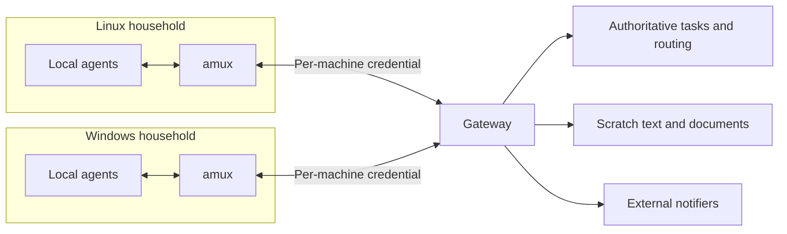

# amux — agent multiplexer

Status: design direction with owner decisions recorded on October 18, 2026.
amux is a full rebuild in the new repository
[github.com/nitecon/amux](https://github.com/nitecon/amux), measured against
this application's capabilities and targets. This document does not authorize
implementation here or change the current standards in
[Docs/Architecture.md](Docs/Architecture.md). The independent review and the
owner's decisions are recorded on gateway task
`01a14fd1-97e2-7583-a766-e4e1d8f18933`.

## Product direction

amux targets Linux, Windows, and macOS. It preserves the useful native
capabilities of today's CMUX while making agent collaboration on one machine
and across machines first-class.

The baseline to measure against is the current application: Linux is the
supported desktop and native Windows is an experimental preview. macOS has no
implementation in this repository. It is a new target with its own acceptance,
not existing behavior to preserve.

Current capabilities form that baseline: terminal panes, splits and tabs,
workspace groups, project actions, agent lifecycle hooks and resume, session
restoration, notifications, CLI/control APIs, SSH and remote transport, port
discovery and forwarding, browser profiles and automation, file and Git views,
updates, and platform integration. Existing limitations and incomplete
acceptance remain explicit; a rebuild does not make them completed features.
See [Components](Docs/Components.md) and [Parity](Docs/Parity.md).

## Household and post office

The owner's model is the US mail system. Agents on one machine live in the same
household: amux runs their terminals and processes, routes fresh notifications
to them, and coordinates their local activity. The gateway is the post office.
It is the single authoritative store for tasks, and it routes work between
households.

The desktop application must stay upgradable and restartable at any time. It
does not own task tracking. Tasks live in the gateway, so an upgrade, crash, or
reboot of a desktop loses no task state. A single-machine installation that
wants task features connects to a gateway, which may run on the same machine.
Without a gateway, terminals, agents, sessions, and local notifications still
work, but task features are unavailable.

The gateway does not own local terminals, rendering, processes, or desktop
session lifetimes.

| Concern | Household: local amux | Post office: gateway |
| --- | --- | --- |
| Agent execution | Own local processes and platform integration | Route work to an eligible machine; execution stays there |
| Tasks | Present, create, claim, and complete tasks through the gateway | Authoritative task store; route cross-machine assignments |
| Scratch text and documents | Pass text inline in tasks and messages | Store scratch text and documents for handoff |
| Availability | Terminals and agents run without a gateway connection | Retain accepted work while a destination is offline or rebooting |
| Notifications | Desktop notifications only | External notifiers such as Discord |

Memory is out of scope for amux. Agents use their native memory or
agent-memory, guided by rules in their harness. amux does not store, sync, or
expose memory.

## Durable cross-machine handoff

For example, a Linux agent requests execution that requires Windows. The gateway
accepts and durably retains the task for an eligible Windows machine. If that
machine is rebooting, the task remains pending. When an agent session on that
machine starts or continues, amux queries pending gateway items and injects a
fresh reminder directly through the owned terminal input path. Provider hooks
and agent-tools hooks are not required for this delivery. The agent decides
whether to claim the work. Results and text artifacts return through the shared
task record.

amux owns reminder delivery and observes the live terminal and process identity.
Before submitting literal input and Enter, verify that the intended agent is
ready and that human input will not be overwritten or interrupted. Defer
delivery when readiness is uncertain. Preserve recipient/process-generation
fences and deduplication across session continuation and reconnect. A reminder
does not automatically claim or re-execute a task. Provider-specific hook
configuration is not the lifecycle or delivery contract: those hooks can change
independently of amux.

The delivery contract distinguishes these states:

1. The sender created a request.
2. The gateway acknowledged durable acceptance.
3. The destination received the assignment.
4. A particular agent on an eligible machine claimed it.
5. Execution started.
6. Execution completed, failed, was cancelled, or requires intervention.

Delivery is at least once, with deduplication. Arbitrary side effects are never
claimed to happen exactly once. A transport write or notification is not proof
that the destination received or executed a task.

Owner decisions on failure handling:

- After a crash or reboot, work is never re-executed automatically. Pending and
  previously claimed items reappear as session-start or continuation reminders,
  and the agent chooses whether to claim them. Memory supplies additional context.
- A reminder for work that was claimed earlier must show who claimed it, from
  which machine, and that the outcome is unknown. Then an agent can check prior
  progress instead of repeating it blindly.
- Each machine has its own gateway credential, and the gateway enforces claim
  eligibility on the server. This gives traceable lineage when something
  breaks.
- The sending agent retries submission until the gateway acknowledges
  acceptance; afterwards the gateway owns retention and routing.

Durable pending tasks and transient terminal notifications have different
retention rules. Preserve the current protection against replaying old gateway
messages into agent input, including the existing five-minute freshness rule.
After reconnect, pending work is recovered through task queries and
directly injected session-start or continuation reminders, not by replaying old
terminal notifications. Keep exact actor/process identity and human input
protection when delivering any fresh agent notification.

An unreachable gateway must not stop local terminals or agents. The UI must
distinguish requests awaiting submission from requests the gateway accepted. A
shared claim succeeds only when the gateway acknowledges it.

## Gateway reuse and known gaps

The existing agent-gateway is the post office to build on; there is no decision
to replace it. First support connecting to one existing deployment. Defer
bundling the gateway with amux: a bundled instance on a sleeping machine is not
reachable, and bundling multiplies upgrade exposure.

A read-only audit of agent-gateway at `5c1a7f9` found these gaps against the
contract above. Paths are under `crates/gateway/src`.

| Gap | Evidence | Required outcome |
| --- | --- | --- |
| Task creation and delegation are not idempotent | New UUID on every call (`db.rs:8300`, `routes.rs:7110-7292`) | A client request ID makes a retried create or delegate return the same task |
| Claims are not conditional | Read, check, then unconditional update (`db.rs:8683-8811`) | Atomic claim that fails if another actor holds it |
| Eligibility is advisory | Hostname, labels, provider, and OS are never checked on claim (`task_events.rs:66-73`) | Server rejects claims from ineligible machines |
| Shared admin credential and self-declared identity | One `GATEWAY_API_KEY` treated as admin (`main.rs:368`, `routes.rs:8864`) | Per-machine credentials bound to the claiming identity |
| Few task states | Only todo, in_progress, and done (`db.rs:1136`) | Received, started, cancelled, and needs-intervention are representable |
| Stale claims silently return to todo | One-hour inactivity reclaim (`db.rs:7593`, `db.rs:8195-8254`) | Reclaimed items keep visible prior-claim history for the reminder |
| Claims emit no events | Only created, commented, and completed events (`task_events.rs:184-198`) | Status comes from task queries; events are only hints |
| No binary artifact storage | Documents retired (`db.rs:1303-1340`); artifacts are text/JSON up to 1 MiB (`db.rs:2291-2313`) | Scratch text works inline; binary handoff is an open question |
| External notifier sends are unbounded | Inline Discord sends with no retry or deduplication (`channels/discord.rs:257-320`) | Bounded, deduplicated delivery that never blocks task writes |

Gateway changes belong to agent-gateway and require a task delegated to its
owner. Before any packaging decision, also check storage, migrations (schema
changes currently run as idempotent statements on every start, with no
versioning), upgrade compatibility, and deployment on the target OSs.

Scratch space on the gateway is required. Work that is unrelated to a
repository must not be committed to Git to share it. Text is passed inline in
tasks and messages, as the gateway does today, without a new mechanism.

## First-class agent capabilities

amux exposes its gateway features without requiring a separate agent-tools
installation. The desktop and the shipped agent-facing interface use the same
underlying operations.

Required capability areas are:

- Task creation, discovery, claims, assignment, delegation, comments,
  completion, cancellation, and handoff context.
- Machine credential, agent identity, platform eligibility, and routing status,
  including pending or uncertain delivery.
- Scratch text and document publication, discovery, and retrieval in task
  handoffs, with provenance preserved.
- Direct terminal injection of pending gateway reminders on session start or
  continuation, and fresh task notifications, without hook dependencies.
- Local desktop notifications.

Memory is excluded, as described above. Code exploration, indexing, and the
knowledge graph from agent-tools are also out of scope unless decided
separately.

An amux CLI/control API is the proposed built-in agent interface; exact commands
and schemas are not yet selected. agent-tools remains usable against the same
gateway. Do not maintain separate task semantics in the UI, the amux CLI, and
agent-tools. agent-tools is Rust and its task client lives in
`crates/agent-comms/src/tasks.rs`. A shared gateway client library is the
cheapest reuse if amux uses Rust; otherwise the gateway HTTP contract is the
only shared artifact. Weigh that cost in the language decision.

## Notification modules

Notification delivery is separate from task storage and orchestration. External
notifiers such as Discord belong to the gateway, which owns their credentials.
amux delivers desktop notifications only. This split prevents the same event
from reaching an external destination twice.

Each notifier owns its delivery attempt and bounded execution. Failure or
slowness in one destination must not block task acceptance, agent execution, or
another notifier. Notification success is separate from task receipt and
execution acknowledgment. Event and delivery identities support deduplication
when retries occur.

Use ordinary module interfaces and a collection of enabled implementations. The
word "plugin" does not require dynamic library loading, a marketplace, or a
general extension framework.

## Language, terminal engine, and UI research

amux is a full rebuild. Language and frontend choices remain open and must be
evaluated against the boundary above and the measured cmux-gtk baseline.

| Candidate | Potential fit | What must be proved |
| --- | --- | --- |
| Go local core with Go/Gio UI | Keeps much of the owned application in Go; GPU interfaces exist | Terminal rendering, native input, IME, accessibility, and packaging across all three OSs |
| Go local core with Rust/GPUI UI | Separates local application logic from a GPU-oriented frontend | Benefit relative to two languages, IPC/FFI, and GPUI API churn |
| Rust local core with a replacement for GTK | Reuses more existing code, the agent-tools gateway client, and platform work | Frontend quality, maintenance cost, and gateway client boundaries |
| C++/Qt Quick frontend with an appropriate local core | Established cross-platform UI and custom GPU integration | Dependency footprint, integration cost, terminal behavior, and browser workflow compatibility |

Go does not inherently prevent Metal, Vulkan, or Direct3D rendering. Conversely,
Rust graphics bindings alone do not justify selecting Rust for all orchestration.
Use existing graphics abstractions rather than introducing separate owned GPU
backends before a measured need exists. GPUI is pre-1.0 and its README warns of
frequent breaking changes.

Keep Ghostty's terminal semantics under consideration independently of its app
runtime and renderer. `libghostty-vt` and the Go bindings provide a possible
cross-platform foundation, but `vt.h` states the API "is not yet stable and is
definitely going to change". The VT library supplies terminal state, not a
renderer, PTY, or widget. Rendering, font shaping/fallback, selection, IME,
accessibility, clipboard, terminal graphics, and resize behavior still require
integration and parity evidence.

Today's surface embeds Ghostty's full runtime with its renderer and PTY over
OpenGL (`src/ghostty/surface.rs`). It also depends on APIs carried in the
`nitecon/ghostty` fork. The gateway's safe-input checks rely on the render grid
(`src/gateway/readiness.rs`). Any VT-based option must provide equivalents of
these as parity items:

- `ghostty_surface_render_grid_json_v` — prompt readiness before delivering
  agent input
- `ghostty_surface_read_screen_tail_vt` — bounded screen tail export
- `ghostty_surface_new_with_replay` — restoring terminal content
- process-directed key input

Deciding where terminal state lives and how a frontend consumes it remains open.
A separate process or terminal display protocol must earn its complexity through
specific lifecycle or performance requirements. A mandatory background terminal
host is not an approved requirement, and gateway-held tasks remove task tracking
as a reason for one.

C can serve narrow native bridges. Assembly or a bespoke low-level graphics
engine would need a demonstrated bottleneck that existing libraries cannot solve.
Neither is currently justified as the application's foundation.

Preserve the browser service boundary while evaluating the terminal and UI.
A toolkit WebView does not establish parity for persistent profiles, extensions,
password managers, automation, or remote routing.

## Decisions and next evidence

Owner decisions, October 18, 2026:

| ID | Decision |
| --- | --- |
| D1 | amux is a full rebuild in `nitecon/amux`, measured against current cmux capabilities and targets |
| D2 | Gateway scratch space is required; text is passed inline in tasks and messages; non-repository work is not committed to Git |
| D3 | Per-machine gateway credentials and server-enforced claim eligibility are required |
| D4 | No automatic re-execution after a crash or reboot; pending items are reminded at session start and agents decide whether to claim |
| D5 | The gateway is the authoritative task store; the desktop does not own task tracking; memory is excluded from amux |
| D6 | amux controls the terminal and directly injects reminders on session start or continuation; delivery must not depend on provider or agent-tools hooks |

Established requirements: terminals and agents work without a gateway; the
gateway is the authoritative task store and cross-machine router; durable
handoff across destination downtime; scratch text and documents on the gateway;
first-class gateway capabilities without agent-tools; external notifiers kept
separate from task ownership; and preservation of existing useful behavior on
Linux and the Windows preview, with macOS as a new target.

Open decisions: language and process model, UI toolkit, terminal embedding
approach, binary artifact handoff, gateway packaging, the gateway gap work
above, and macOS acceptance scope.

Proposed evaluation gates:

1. Delegate the gateway gaps above to agent-gateway.
2. Prove handoff against the gateway before any UI work:
   - Linux delegates to Windows while Windows is off, then Windows reconnects
     and receives a reminder.
   - Killing an executor after it starts produces needs-intervention with
     prior-claim history and no automatic rerun.
   - Retrying the same request ID creates no duplicate task.
3. Compare representative terminal/UI prototypes against cmux-gtk on one OS
   before committing to a stack. Measure input latency, output throughput, idle
   CPU, memory, IME, prompt-readiness parity, and packaging costs. Do not
   prototype every candidate.

Acceptance also includes gateway operations with agent-tools absent and notifier
failure isolation. Prove pending-task reminder delivery with provider hooks
unconfigured or disabled and agent-tools absent, including session continuation,
busy or partially typed input, reconnect, and duplicate suppression. Follow each
repository's GitHub Actions verification policy;
this document does not authorize implementation or local tests.

## Research references

These references support the initial research; verify versions and behavior
again when selecting dependencies. Recommendations above are not benchmark
results or claims of proven feature parity.

- [Ghostty and its embeddable library](https://github.com/ghostty-org/ghostty)
- [Ghostling: scope of the VT library and a minimal consumer](https://github.com/ghostty-org/ghostling)
- [Ghostty VT C API and stability warning](https://github.com/ghostty-org/ghostty/blob/main/include/ghostty/vt.h)
- [Go libghostty bindings, cgo, and cross-compilation](https://tangled.org/mitchellh.com/go-libghostty/tree/main)
- [Gio platform support](https://gioui.org/) and [GPU interfaces](https://pkg.go.dev/gioui.org/gpu)
- [GPUI development status](https://github.com/zed-industries/zed/tree/main/crates/gpui)
- [wgpu graphics backends](https://wgpu.rs/doc/wgpu/documentation/features/index.html)
- [Qt Quick custom graphics integration](https://doc.qt.io/qt-6/qtquick-visualcanvas-scenegraph.html)
- [Qt WebEngine extension manager](https://doc.qt.io/qt-6.10/qwebengineextensionmanager.html)
- [WezTerm multiplexing as an optional session-lifecycle reference](https://wezterm.org/multiplexing.html)
