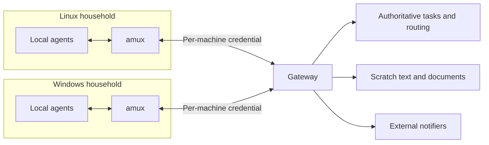

# amux architecture

This document records the design direction and owner decisions from October 18,
2026. amux is a full rebuild in `nitecon/amux`; the contracts below are design
requirements, not claims of implemented behavior or authorization to implement.
The independent review and owner decisions are recorded on gateway task
`01a14fd1-97e2-7583-a766-e4e1d8f18933`.

See [features](features.md) for product direction, the CMUX capability baseline,
agent capabilities, and acceptance scenarios. See [tooling](tooling.md) for stack
candidates, terminal integration, client reuse, research, and evaluation gates.
The baseline [Architecture][cmux-architecture], [Components][cmux-components], and
[Parity][cmux-parity] documents belong to cmux-linux at commit `dc9bc256`.
This design does not change that repository's standards.

## Local households and the gateway post office

Agents on one machine form a household. amux owns their local terminals,
processes, fresh notification routing, and the local control interface. The gateway is
the post office: it holds authoritative task state and routes work between
households. It does not manage terminal rendering, local processes, or desktop
session lifetimes.

| Responsibility | amux household | Gateway post office |
| --- | --- | --- |
| Agent execution | Run local processes and platform integration | Route assignments to eligible machines; execution remains local |
| Tasks | Present, create, claim, and complete through gateway operations | Store authoritative tasks and route cross-machine work |
| Scratch text and documents | Pass text inline through tasks and messages | Retain scratch text and documents for handoff |
| Availability | Keep terminals and agents running without a gateway | Retain accepted assignments while destinations are offline or rebooting |
| Notifications | Deliver desktop notifications | Own external notifiers such as Discord |

Gateway-accepted task state survives desktop upgrades, crashes, and reboots. The desktop must
remain restartable and upgradable at any time because the gateway, rather than
amux, owns task tracking. Even a single-machine installation needs a gateway for
task features; that gateway may run on the same machine. Without one, terminals,
agents, sessions, and local notifications remain available, while task features
are unavailable. Requests still awaiting gateway acceptance are separate: their
local persistence remains undecided. This does not introduce a second task store,
durable outbox, or mandatory background terminal host.

Memory is outside amux's scope. Agents use native memory or agent-memory under
their harness rules. amux does not store, synchronize, or expose memory. Code
exploration, indexing, and the agent-tools knowledge graph are also excluded
unless separately approved.

## Durable handoff between machines

When a Linux agent requests Windows execution, the gateway accepts and retains
the task for an eligible Windows machine. Destination downtime does not discard
accepted work. At agent session start or continuation, amux queries pending tasks
and delivers a fresh reminder through the terminal input path it owns. The agent
chooses whether to claim the work; results and text artifacts return through the
shared task record.

### Terminal delivery and recipient protection

amux observes the live terminal and process identity. Before sending literal
input and Enter, it must establish that the intended agent is ready and that
delivery will neither overwrite nor interrupt human input. Uncertain readiness
means deferred delivery. Recipient and process-generation fences, exact actor
identity, and deduplication must survive session continuation and reconnect.

Terminal injection requires explicit user consent. Withdrawing consent retires
pending terminal deliveries; it does not discard accepted gateway tasks. This
preserves the [CMUX consent boundary][cmux-consent] without selecting a new UI.

Reminders do not claim tasks or start execution automatically. Provider lifecycle
integrations remain baseline mechanisms for resume, status and turn notifications
(see [features](features.md)). D6 removes provider and agent-tools hooks as
prerequisites for reminder delivery; their configuration is not its lifecycle
contract and can change independently of amux.

### Delivery contract

These stages describe required evidence, not a selected database enum or new
provider protocol. The gateway remains authoritative for shared task records;
local observations establish only what amux can actually observe.

| Stage | Recorder / acknowledgment | Evidence and limit |
| --- | --- | --- |
| 1. Requested | Sending agent/client | A request with a stable sender request identity exists locally. No gateway acceptance is implied; persistence before acceptance is undecided. |
| 2. Accepted | Gateway, acknowledged to sender | A committed task record and returned canonical task identity acknowledge durable acceptance. A lost reply leaves the sender uncertain, so it retries the same request identity. |
| 3. Received | Destination amux observes receipt; its explicit receipt report, if available, is recorded by the gateway | Fetching the assignment proves destination application receipt only. A socket write by the sender proves neither destination receipt nor agent understanding. Without a destination report, shared receipt remains unknown. |
| 4. Claimed | Agent requests claim; gateway checks identity/eligibility and records/acknowledges ownership | The gateway confirms the particular actor and eligible machine. Neither reminder submission nor a local claim request is sufficient. A claim is not execution start. |
| 5. Started | Claiming agent/executor explicitly reports start; gateway records the report | A report tied to task and claimant establishes reported execution start. Terminal input, Enter, prompt appearance, notification success and claim alone do not prove it. Without a report, start remains unknown. |
| 6. Outcome | Executing agent reports completion/failure; cancellation or intervention is explicitly recorded with its reporting actor | The gateway records the reported result and provenance. Missing results after interruption remain unknown and require checking; an unresponsive executor is not proof of completion, failure, or cancellation. |

Within delivery, distinguish destination transport receipt, safe terminal
submission and actual agent acknowledgment. amux can record that its readiness
and identity checks passed and that literal input/Enter was submitted, deferred,
or uncertain. That is an input-path observation, not semantic receipt by the
agent. Only an explicit agent report (including a deliberate gateway claim as
an acknowledgment of ownership) provides agent evidence, and even a claim does
not establish Started. Ordinary terminal agents can read reminders and report
through the agent-facing interface; no provider hook, special launcher, screen
heuristic, or mandatory semantic acknowledgment detector is assumed. The exact
reporting API and storage representation remain open.

Delivery is at least once with deduplication. This contract does not promise
exactly-once arbitrary side effects.

The sender retries submission until the gateway acknowledges acceptance. From
that acknowledgment onward, the gateway owns retention and routing. Each machine
uses its own credential, and claim eligibility is enforced by the gateway so
the execution lineage remains traceable. A shared claim succeeds only after the
gateway acknowledges it.

### Retry identity and deduplication

Owner clarification, October 22, 2026: each running Claude or Codex session has
its own identity, even when three agents share the same project, machine and
provider. The project identifies the work queue; it never identifies a claimant.
Claims, delegation targets, comments and execution reports must identify the exact
session. A restarted native execution gets a new instance fence and cannot silently
inherit another session's ownership. Deliberate handoff is explicit and retains
the earlier claimant's history. A provider label or machine-wide agent name is
insufficient to distinguish those three agents.

Keep these relationships without prescribing a new schema:

- A sender-scoped request identity stays stable when retrying the same submission.
  The gateway maps those retries to one canonical task identity. A distinct request
  must not reuse that identity to conceal different work.
- Task identity follows the durable work through routing, claims and reports.
  Delivery/reminder identity distinguishes a particular reminder from the task;
  retries of that delivery retain its identity and recipient fence.
- A recipient fence identifies the destination machine, agent session/instance,
  terminal surface and native process generation. Reports and deduplication must
  remain attributable to that recipient, not merely a project name or PID.
- Duplicate events or delivery retries must not submit the same reminder again
  to the same recipient generation. A transport reconnect cannot retarget an old
  delivery to a different process. Preserve uncertain-submission fences rather
  than blindly retrying a possibly submitted input. Repeated task queries must
  not manufacture new delivery identities for the same intended reminder.

A new session can receive a newly constructed reminder for the same pending task
after an authoritative query. That is recovery context with prior-claim history,
not replay permission for old input or automatic re-execution. Reminder
deduplication does not make arbitrary task side effects idempotent.

### Crash, reconnect, and freshness behavior

Crashes and reboots never trigger automatic re-execution. Pending and previously
claimed work returns as session-start or continuation reminders, leaving the
claim decision to an agent. For previously claimed work, the reminder must name
the claimant and machine and make the unknown outcome explicit. The recipient
can then check earlier progress, with additional context supplied by the agent's
memory, instead of blindly repeating work.

After a crash following claim or a reported start, the last gateway record remains
evidence of ownership or reported start, not a known outcome. Recovery must expose
that uncertainty and the need to check progress before any new claim/execution.
No specific persisted `needs-intervention` enum is selected by this wording.

Durable tasks and transient terminal notifications have separate retention
rules. Keep the existing five-minute freshness protection against replaying old
gateway messages into agent input. Reconnect recovers pending work by querying
tasks and directly injecting fresh reminders, rather than replaying old terminal
notifications. Every fresh notification retains the same actor/process fences
and human-input protection.

An unreachable gateway must not stop local terminals or agents. The UI must
distinguish a request still awaiting submission from one durably accepted by the
gateway; local submission alone cannot establish a shared claim.

## Gateway reuse, scratch space, and known gaps

Build on the existing agent-gateway. Replacement has not been selected. The
recommended initial plan is to connect to one existing deployment and defer
bundling: a gateway bundled on a sleeping machine is unreachable, and bundling
increases upgrade exposure. This is a packaging recommendation, not an additional
D1-D6 decision; gateway packaging remains open.

Gateway scratch space is required for text and documents. Work unrelated to a
repository must not be committed to Git merely to share it. Use the existing
inline task and message text mechanism rather than creating another one. Binary
artifact handoff remains undecided.

The following is historical evidence from a read-only audit of agent-gateway at
commit `5c1a7f9`, not a claim about its current implementation. All evidence paths
are relative to that repository's `crates/gateway/src` directory.

| Gap at `5c1a7f9` | Evidence | Required outcome |
| --- | --- | --- |
| Create and delegate calls are not idempotent | A new UUID on each call: [db.rs:8300][gw-create-id], [routes.rs:7110-7292][gw-create-delegate] | Retrying with a client request ID returns the same task |
| Legacy or unattributed ownership lacks the same origin fence | Handler holds DB mutex across read/check/update ([routes.rs:7352-7380][gw-claims]); mutation is transactional ([task_events.rs:84-100][gw-transaction]); attributed ownership checks session/instance ([db.rs:8683-8811][gw-owner]) | Preserve existing serialized transactional claims and exact-origin checks; cover legacy/unattributed ownership, authenticated machine binding and enforced eligibility. Future multiple-writer guarantees require separate evidence, not a blanket claim-atomicity rewrite. |
| Eligibility is advisory | Claim does not check hostname, labels, provider, or OS: [task_events.rs:66-73][gw-origin] | Server rejects ineligible machines |
| Shared admin credential and self-declared identity | One `GATEWAY_API_KEY` is treated as admin: [main.rs:368][gw-key], [routes.rs:8864][gw-admin] | Per-machine credentials bind the claiming identity |
| Task reporting coverage is limited | Only todo, in_progress, and done: [db.rs:1136][gw-status] | Represent receipt/start/outcome reports without inferring execution from a claim; exact schema remains open |
| Reclaim warning lacks prior-claim provenance in recovered task summaries | Generic prior-progress warning is inserted before ownership/session/start fields are cleared: [db.rs:8195-8254][gw-reclaim] | Preserve the earlier claimant and machine in recovery context; do not describe reclaim as silent |
| Ordinary claim/release lifecycle events are absent | Events cover only creation, comments, and completion: [task_events.rs:184-198][gw-events] | Queries establish task status; events serve only as hints |
| No generic binary artifact handoff | Dedicated documents retired: [db.rs:1303-1340][gw-doc-retirement]; artifact text bodies capped at 1 MiB and structured payloads at 512 KiB: [db.rs:2291-2313][gw-text-limits] | Inline scratch text works; binary handoff remains open |
| No explicit application-level delivery budget, queue or deduplication in the external adapter/handler | Inline Discord calls: [channels/discord.rs:257-320][gw-discord]; message publication awaits them: [routes.rs:4714-4796][gw-message] | Bound and isolate external delivery with deduplication; dependency-internal retry/timeout is not disproved. [Task creation][gw-create] does not call Discord, so this is not evidence that all task writes currently block on notifiers. |

The absence of a SQL compare-and-set predicate is not evidence of an ordinary
single-process claim race under the mutex and transaction above. Identity
authentication and eligibility are separate guarantees still missing at this
revision. Inline scratch task/message text already exists; retirement of the
dedicated documentation subsystem does not remove that mechanism.

Any gateway changes belong in agent-gateway under a task delegated to that
project's owner. Before choosing packaging, check storage, migrations, upgrade
compatibility, and deployment on the target operating systems. At the audited
revision, schema changes ran as idempotent statements on every startup without
migration versioning.

## Notification module boundary

Notification delivery is separate from task storage and orchestration. The
gateway owns external notifiers and their credentials; amux delivers desktop
notifications only. Keeping external delivery in one place prevents duplicate
sends from both the gateway and the desktop.

Each notifier owns bounded delivery attempts. A slow or failing destination must
not block task acceptance, agent execution, or another notifier. Notification
success remains distinct from task receipt and execution acknowledgment. Event
and delivery identities allow deduplication across retries.

Use ordinary module interfaces with a collection of enabled implementations.
There is no requirement for dynamic library loading, a marketplace, or a general
plugin framework.

## Owner decisions and open questions

The owner recorded these decisions on October 18, 2026:

| ID | Decision |
| --- | --- |
| D1 | Rebuild amux in `nitecon/amux`, measuring against current CMUX capabilities and targets |
| D2 | Require gateway scratch space; pass text inline in tasks and messages; keep non-repository work out of Git |
| D3 | Require per-machine gateway credentials and server-enforced claim eligibility |
| D4 | Never automatically re-execute after crash or reboot; remind agents of pending items at session start and let them choose whether to claim |
| D5 | Keep authoritative tasks in the gateway, task tracking out of the desktop, and memory outside amux |
| D6 | Have amux directly inject terminal reminders at session start or continuation without depending on provider or agent-tools hooks |

The established scope includes offline local terminals and agents, durable
handoff through destination downtime, gateway scratch text and documents,
first-class gateway operations without agent-tools, and external notifiers
separate from task ownership. Preserve useful Linux behavior and the Windows
preview baseline; macOS is a new target with acceptance still to define. See
[features](features.md) for the capability and acceptance details.

Open decisions remain the language and process model, UI toolkit, terminal
embedding approach, binary artifact handoff, gateway packaging, the gateway gap
work listed above, and macOS acceptance scope. A mandatory background terminal
host is not approved; gateway task ownership does not justify one. A separate
process or terminal display protocol must earn its complexity through specific
lifecycle or performance requirements.

The proposed evaluation gates and prototype metrics belong in
[tooling](tooling.md). Production cross-machine execution acceptance requires
gateway handoff evidence; independent terminal/UI feasibility work need not wait
for it. These evaluation recommendations do not select a stack or authorize
prototype implementation. Follow
each repository's GitHub Actions verification policy. This design does not
authorize implementation or local tests.

[cmux-architecture]: https://github.com/nitecon/cmux-gtk/blob/dc9bc256d9b680170124edaaed5e1d3702c4a066/Docs/Architecture.md
[cmux-components]: https://github.com/nitecon/cmux-gtk/blob/dc9bc256d9b680170124edaaed5e1d3702c4a066/Docs/Components.md
[cmux-parity]: https://github.com/nitecon/cmux-gtk/blob/dc9bc256d9b680170124edaaed5e1d3702c4a066/Docs/Parity.md
[cmux-consent]: https://github.com/nitecon/cmux-gtk/blob/dc9bc256d9b680170124edaaed5e1d3702c4a066/src/gateway/ui.rs#L1-L36
[gw-claims]: https://github.com/nitecon/agent-gateway/blob/5c1a7f91e19383feeafc07c4945b936e8618a249/crates/gateway/src/routes.rs#L7352-L7380
[gw-transaction]: https://github.com/nitecon/agent-gateway/blob/5c1a7f91e19383feeafc07c4945b936e8618a249/crates/gateway/src/task_events.rs#L84-L100
[gw-owner]: https://github.com/nitecon/agent-gateway/blob/5c1a7f91e19383feeafc07c4945b936e8618a249/crates/gateway/src/db.rs#L8683-L8811
[gw-reclaim]: https://github.com/nitecon/agent-gateway/blob/5c1a7f91e19383feeafc07c4945b936e8618a249/crates/gateway/src/db.rs#L8195-L8254
[gw-discord]: https://github.com/nitecon/agent-gateway/blob/5c1a7f91e19383feeafc07c4945b936e8618a249/crates/gateway/src/channels/discord.rs#L257-L320
[gw-message]: https://github.com/nitecon/agent-gateway/blob/5c1a7f91e19383feeafc07c4945b936e8618a249/crates/gateway/src/routes.rs#L4714-L4796
[gw-create]: https://github.com/nitecon/agent-gateway/blob/5c1a7f91e19383feeafc07c4945b936e8618a249/crates/gateway/src/routes.rs#L7110-L7174
[gw-create-id]: https://github.com/nitecon/agent-gateway/blob/5c1a7f91e19383feeafc07c4945b936e8618a249/crates/gateway/src/db.rs#L8300
[gw-create-delegate]: https://github.com/nitecon/agent-gateway/blob/5c1a7f91e19383feeafc07c4945b936e8618a249/crates/gateway/src/routes.rs#L7110-L7292
[gw-origin]: https://github.com/nitecon/agent-gateway/blob/5c1a7f91e19383feeafc07c4945b936e8618a249/crates/gateway/src/task_events.rs#L1-L80
[gw-key]: https://github.com/nitecon/agent-gateway/blob/5c1a7f91e19383feeafc07c4945b936e8618a249/crates/gateway/src/main.rs#L368
[gw-admin]: https://github.com/nitecon/agent-gateway/blob/5c1a7f91e19383feeafc07c4945b936e8618a249/crates/gateway/src/routes.rs#L8864
[gw-status]: https://github.com/nitecon/agent-gateway/blob/5c1a7f91e19383feeafc07c4945b936e8618a249/crates/gateway/src/db.rs#L1136
[gw-events]: https://github.com/nitecon/agent-gateway/blob/5c1a7f91e19383feeafc07c4945b936e8618a249/crates/gateway/src/task_events.rs#L184-L198
[gw-doc-retirement]: https://github.com/nitecon/agent-gateway/blob/5c1a7f91e19383feeafc07c4945b936e8618a249/crates/gateway/src/db.rs#L1303-L1340
[gw-text-limits]: https://github.com/nitecon/agent-gateway/blob/5c1a7f91e19383feeafc07c4945b936e8618a249/crates/gateway/src/db.rs#L2291-L2313
